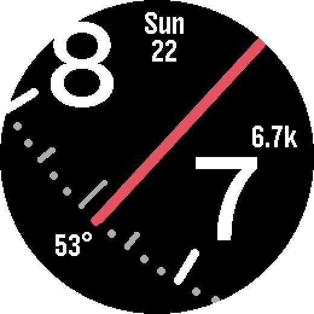

# Arcminute Complications



A fork of **[Arcminute](https://github.com/arfct/arcminute-watchface)** by
[Nicholas Jitkoff (arfct)](https://github.com/arfct), adding complications to
the Pebble watchface. All credit for the watchface itself — the hyper-accurate
hour hand cropped to the clock's perimeter, the dial design, the colors and the
config page — goes to the original project. Please go star it. ⭐

This fork adds three complications to the **Pebble Round 2 (gabbro)** version:

- **Date**, stacked as "Sun" over "22"
- **Current temperature** (°F or °C), from [Open-Meteo](https://open-meteo.com) using your phone's location (no API key)
- **Step count**, abbreviated above 999 steps (`999`, `1.4k`, `10.2k`)

By default the complications appear only when you **shake or tap the watch
once**, and hide again after 5 seconds. A setting switches them to always-on.

## How the layout works

Arcminute's dial is a huge circle that slides behind the screen, and the hour
hand always passes through the screen centre. That means every complication
can be placed in polar coordinates around the centre using only the hand
angle, with no collision detection:

| Complication | Position |
|---|---|
| Temperature | On the hand's axis, just past the tip, outside the dial |
| Date | Behind the hand, 38° to one side, in the empty part of the dial |
| Steps | Behind the hand, 38° to the other side |

Labels are drawn in Gothic 28 Bold and clamped to stay inside the round screen.
At some times of day a label can touch a neighbouring hour numeral.

## Settings

Open the watchface settings on your phone (all of the original Arcminute
settings are still there):

- **Show complications**: On shake / tap (default) or Always
- **Temperature unit**: Fahrenheit (default) or Celsius

## Building

Requires the [Pebble SDK](https://developer.repebble.com).

```sh
cd pebble
npm install
pebble build
pebble install --emulator gabbro      # or: pebble install --phone <ip>
```

In the emulator you can drive the complications with:

```sh
pebble emu-tap --emulator gabbro                  # shake / tap
pebble emu-steps 6712 --emulator gabbro
pebble emu-set-location 37.77 -122.42 --emulator gabbro
```

## What changed from the original

- `pebble/src/c/arcminute.c`: complications layer, tap handling, step formatting, weather cache
- `pebble/src/pkjs/`: weather fetch and the two new Clay settings
- `pebble/package.json`: new app name and UUID (so it installs alongside the original), `gabbro` is the only target platform, `location` capability, new message keys

The Wear OS port in [`wear/`](wear/) is the original, unmodified, and has no
complications. Only the Pebble Round 2 build of this fork has been tested.

## License

MIT, same as the original. See [LICENSE](LICENSE); the original copyright
notice (© 2025 Nicholas Jitkoff) is retained.
